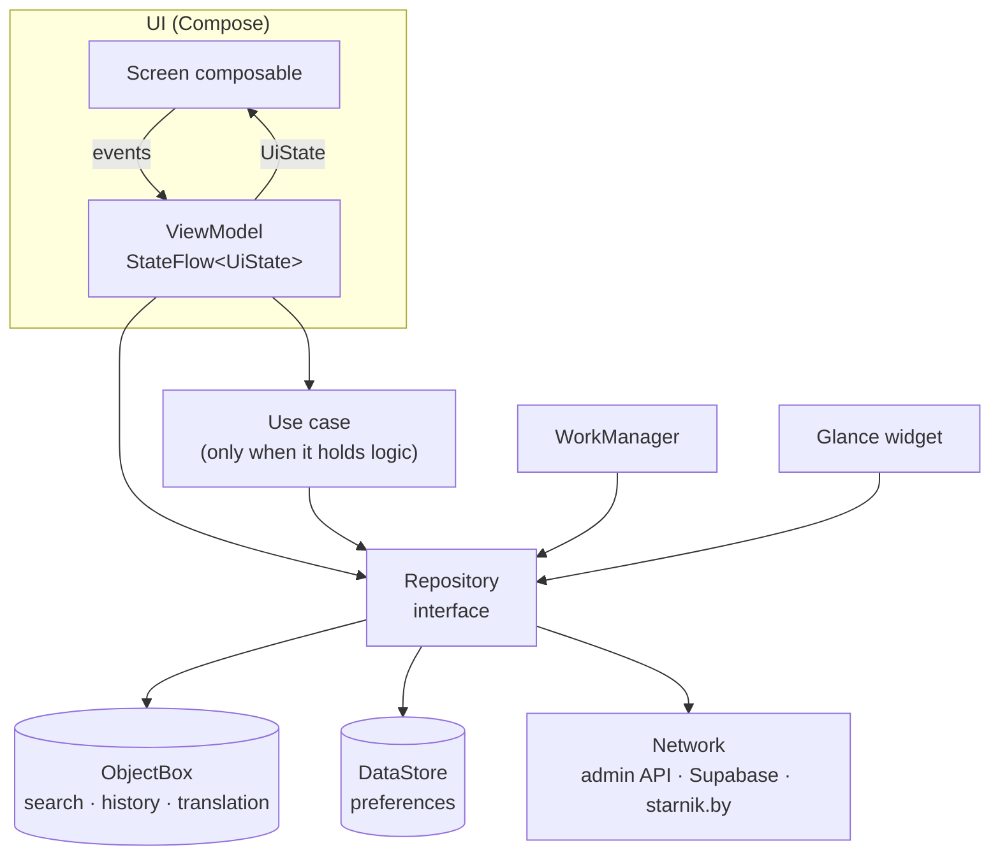
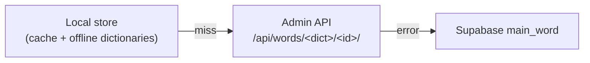

# Architecture

Living reference for how the app is built. It describes the target shape; sections marked *(planned)*
arrive with the feature PR named in [parity.md](parity.md). Why a choice was made lives in [adr/](adr/README.md).

## Overview



One Activity (`MainActivity`) hosts a Compose `NavHost`. Each screen has one ViewModel exposing a single
immutable `UiState` as `StateFlow`; the screen renders it and sends events back as method calls. ViewModels
call use cases where there is real logic (search fallbacks, translation chain, downloads) and repositories
directly otherwise. Repositories are interfaces owned by the feature; implementations sit in the feature's
`data` package and are bound with Hilt `@Binds`.

## Packages

```
by.mazokaleh.skarnik
├── SkarnikApplication, MainActivity
├── navigation/            NavHost, top-level routes, bottom bar
├── ui/theme/              Material 3 theme
├── core/
│   ├── common/            dispatcher qualifiers, result helpers
│   ├── model/             Dictionary and other shared domain types
│   ├── database/          ObjectBox entities, store opener, SkarnikDatabase
│   ├── network/           (planned) HTTP client, cache, Supabase client
│   └── analytics/         (planned) consent-gated event logger
└── feature/
    ├── home/              (skeleton placeholder, becomes the History tab)
    ├── search/            (planned)
    ├── translation/       (planned)
    ├── history/ favorites/ vocabulary/ settings/ stress/ widget/   (planned)
```

Each feature uses `data/` (repository implementations, DTOs), `domain/` (use cases, feature models, only
if needed) and `ui/` (screens, ViewModels, UiState). A single Gradle module for now; features move into
modules only if build times call for it.

## Theme

`ui/theme/SkarnikTheme` takes `ThemeMode` (System/Light/Dark) and `useDynamicColor`. Dynamic colour
(Android 12+) is the default; the brand palette (white/`#E1251B`, `#0F0F10`/`#FF4438`, as on skarnik.app) is
used when the user turns dynamic colour off or the device is older. Both settings are stored in DataStore by
the settings feature and read once at the root. Translation HTML colours are mapped to colour-scheme roles so
they stay readable in every scheme.

## Dependency injection

Hilt with KSP. `SingletonComponent` holds the database, HTTP client and repositories; ViewModels use
`@HiltViewModel`. Coroutine dispatchers are injected through `@IoDispatcher` and `@DefaultDispatcher` so
tests can swap them.

## Navigation

Navigation Compose with type-safe routes (`@Serializable` objects/classes). Target graph, mirroring Flutter:

- Bottom bar: History (start), Bookmarks, Dictionary (vocabulary). Each tab keeps its own back stack.
- Full-screen: Search, Settings, Translation(`langId`, `wordId`), Stress(`word`) → Stress table.
- Large screens: list–detail (search/history/bookmarks list with translation beside it).
- Deep links `skarnik.by/<dict>/<id>` and `skarnik.app/r/<dict>/<id>` open Translation.

## Local storage

Three ObjectBox stores, inherited from the Flutter app and opened at the same paths with the same model
UIDs ([ADR 0001](adr/0001-objectbox-on-flutter-stores.md)):

| Store | Directory | Entities | Contents |
|---|---|---|---|
| search | `app_flutter/objectbox_search` | `ObjectboxSearchWord` | ~316k words, seeded on first launch from `assets/objectbox/data.mdb.gz` |
| history | `app_flutter/objectbox_history` | `ObjectboxHistoryWord`, `ObjectboxFavoriteWord` | search history and bookmarks |
| translation | `app_flutter/objectbox_translation` | `ObjectboxTranslationWord` | cached translations and downloaded offline dictionaries |

`SkarnikDatabase.stores()` opens all three once, lazily, on the IO dispatcher. Small key-value settings
(analytics consent, bookmark sort order, review counter, download cursors, widget history) move to DataStore,
migrated from Flutter's `FlutterSharedPreferences` by the feature that owns each key.

## Search *(planned)*

Ported from `ObjectboxSearchRepository`: lowercase → prefix query on `lword`, then on `lwordMask`, each with
and without letter substitutions (и→і, е→ё, щ→ў, ъ/'→‘); fuzzy Damerau–Levenshtein over the first-letter bucket
when nothing matched and the query has ≥3 letters; retry without a glued one-letter preposition. Runs on
`@DefaultDispatcher`. Golden tests pin results captured from the Flutter app.

## Translation *(planned)*

Fallback chain, ported from `GetTranslationUseCase` without its last step (the skarnik.by page scrape, dropped):



Any source may answer with `redirectTo`, which navigates to the target word. Translation HTML is rendered
natively (decision in an ADR with the translation PR). HTTP goes through one OkHttp client with a disk
cache; cache lifetime comes from Remote Config like in Flutter.

## Background work and widget *(planned)*

WorkManager refreshes the word-of-the-day widget hourly plus once on first add, as Flutter does; offline
dictionary downloads run as resumable work with a persisted cursor. The widget is Glance (Flutter already
uses a native Glance widget, which is reused).

## Analytics and crash reporting *(planned)*

Firebase Analytics and Remote Config behind small interfaces with a no-op/logging debug implementation.
Analytics collection is disabled until the user answers the consent dialog; event names match Flutter.
Crash and error reporting goes to Sentry (sponsored org `skarnik`) in release builds, instead of Crashlytics.

## Testing

- JVM unit tests for logic, repositories and ViewModels (fakes, coroutines-test, Turbine).
- ObjectBox runs in JVM tests via `objectbox-linux`; `ObjectBoxStoreOpenerTest` opens the real Flutter seed DB.
- Compose UI tests for key screens; screenshots of Flutter screens in `docs/screens/` as the visual reference.
- CI (GitHub Actions): ktlint, detekt, Android Lint, unit tests, debug APK artifact, ObjectBox model drift check.
