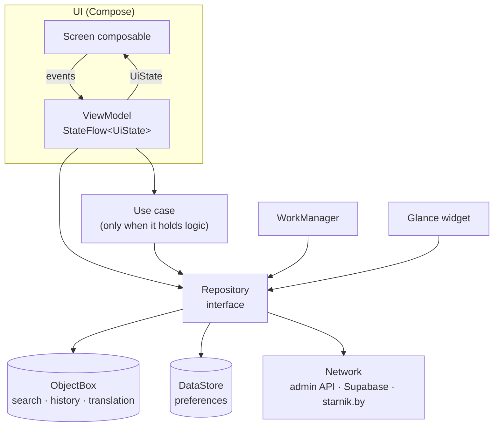
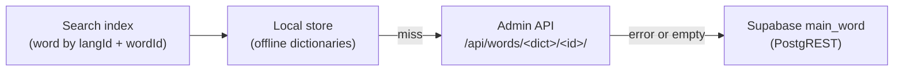

# Architecture

Living reference for how the app is built. It describes the target shape; sections marked *(planned)*
arrive with the feature PR named in [parity.md](parity.md). Why a choice was made lives in [adr/](adr/README.md).

## Overview



One Activity (`MainActivity`) hosts a Compose `NavHost`. Each screen has one ViewModel exposing a single
immutable `UiState` as `StateFlow`; the screen renders it and sends events back as method calls. ViewModels
call use cases where there is real logic (search fallbacks, translation chain, downloads) and repositories
directly otherwise. Repositories are interfaces owned by the feature; implementations sit in the feature's
`data` package and are bound with Hilt `@Binds`.

## Packages

```
by.mazokaleh.skarnik
├── SkarnikApplication, MainActivity
├── navigation/            NavHost, top-level routes, bottom bar
├── ui/theme/              Material 3 theme
├── core/
│   ├── common/            dispatcher qualifiers, result helpers
│   ├── model/             Dictionary and other shared domain types
│   ├── database/          ObjectBox entities, store opener, SkarnikDatabase
│   ├── network/           OkHttp client with disk cache, suspend calls
│   └── analytics/         (planned) consent-gated event logger
└── feature/
    ├── home/              top-level screen with the navigation bar
    ├── search/            word search
    ├── translation/       translation screen, source chain, HTML renderer
    ├── history/ favorites/   History and Bookmarks tabs, their repositories and the sort setting
    ├── vocabulary/ settings/ stress/ widget/   (planned)
```

Each feature uses `data/` (repository implementations, DTOs), `domain/` (use cases, feature models, only
if needed) and `ui/` (screens, ViewModels, UiState). A single Gradle module for now; features move into
modules only if build times call for it.

## Theme

`ui/theme/SkarnikTheme` takes `ThemeMode` (System/Light/Dark) and `useDynamicColor`. Dynamic colour
(Android 12+) is the default; the brand palette (white/`#E1251B`, `#0F0F10`/`#FF4438`, as on skarnik.app) is
used when the user turns dynamic colour off or the device is older. Both settings are stored in DataStore by
the settings feature and read once at the root. Translation HTML colours are mapped to colour-scheme roles so
they stay readable in every scheme.

## Dependency injection

Hilt with KSP. `SingletonComponent` holds the database, HTTP client and repositories; ViewModels use
`@HiltViewModel`. Coroutine dispatchers are injected through `@IoDispatcher` and `@DefaultDispatcher` so
tests can swap them.

## Navigation

Navigation Compose with type-safe routes (`@Serializable` objects/classes). Target graph, mirroring Flutter:

- `HomeRoute` holds the bottom bar: History (start), Bookmarks, Dictionary (vocabulary, planned). Tabs switch
  inside the one destination; a `SaveableStateHolder` keeps each tab's scroll position and its ViewModel lives
  on the `HomeRoute` entry, so hidden tabs keep their data. Back on another tab returns to History. Search and
  Translation open full screen above it.
- Full-screen: Search, Settings, Translation(`langId`, `wordId`, `word`), Stress(`word`) → Stress table.
- Large screens: list–detail (search/history/bookmarks list with translation beside it).
- Deep links `skarnik.by/<dict>/<id>` and `skarnik.app/r/<dict>/<id>` open Translation.

## Local storage

Three ObjectBox stores, inherited from the Flutter app and opened at the same paths with the same model
UIDs ([ADR 0001](adr/0001-objectbox-on-flutter-stores.md)):

| Store | Directory | Entities | Contents |
|---|---|---|---|
| search | `app_flutter/objectbox_search` | `ObjectboxSearchWord` | ~316k words, seeded on first launch from `assets/objectbox/search_seed.mdb.gzip` |
| history | `app_flutter/objectbox_history` | `ObjectboxHistoryWord`, `ObjectboxFavoriteWord` | search history and bookmarks |
| translation | `app_flutter/objectbox_translation` | `ObjectboxTranslationWord` | cached translations and downloaded offline dictionaries |

`SkarnikDatabase.stores()` opens all three once, lazily, on the IO dispatcher. Small key-value settings
(analytics consent, bookmark sort order, review counter, download cursors, widget history) move to DataStore,
migrated by the feature that owns each key from Flutter's `files/datastore/FlutterSharedPreferences.preferences_pb`
(Flutter's `SharedPreferencesAsync` is a Preferences DataStore on Android, so it is read with DataStore itself).
Flutter's HTTP response cache `DioCache.db` is a cache, not user data, and is deleted once after the upgrade.

## Search

`feature/search`: `SearchWordsUseCase` (domain) holds the algorithm ported from `ObjectboxSearchRepository`;
`SearchIndex` is the query interface, implemented on the search store by `ObjectBoxSearchIndex` (IO dispatcher).

1. Lowercase; prefix query on `lword`, then on `lwordMask` minus the ids already found, each for the query as
   typed and with letter substitutions (и→і, е→ё, щ→ў, ъ/'→‘), case-sensitive (the index is lowercase), 15 per stage.
2. Nothing found and ≥3 letters: load the first-letter bucket (up to 65k rows) and rank by Damerau–Levenshtein
   (distance 1 up to 5 letters, else 2) on `@DefaultDispatcher`.
3. Still nothing and the query starts with a one-letter preposition/conjunction: run 1–2 once without it.

`SearchViewModel` trims and debounces the query (50 ms, like Flutter) and cancels a running search when the
query changes (`mapLatest`). The screen is a full-screen expanded M3 `SearchBar` opened from a collapsed bar on
the start screen. `ObjectBoxSearchTest` runs the algorithm against the real bundled index.

## Translation

`feature/translation`, ported from Flutter's `TranslationCubit` and `GetTranslationUseCase`
([ADR 0003](adr/0003-translation-network-and-html.md)):



- `TranslationRoute(langId, wordId, word?, saveToHistory, redirectedFrom?)`; the ViewModel is assisted-injected
  with the route. It looks the word up in the index (so links and redirects open by id), runs the chain, saves
  the word to history (unless opened from history/bookmarks) and reads the bookmark state.
- Any source may answer with `redirect_to` (a `WordLink`: `skarnik.by/<dict>/<id>`, `skarnik.app/r/...` or a bare
  path); the target replaces the alias in the back stack and shows «Перанакіравана з «…»».
- Both network sources go through one OkHttp client; a network interceptor makes successful GETs fresh for 24 h
  in a 20 MB disk cache (`cache/http`). Remote Config takes over the lifetime later.
- `translationHtmlToAnnotatedString` parses the HTML with jsoup and maps legacy colours to colour-scheme roles;
  links are `LinkAnnotation`s. The text is selectable.
- History and bookmark writes live in `feature/history/data` and `feature/favorites/data`; the tabs that list
  them come with their own PRs.

## History and bookmarks

`feature/history` and `feature/favorites` read the history store through `BoxStore.changes<T>()`
(`core/database/ObjectBoxChanges.kt`): a Flow that emits once and after every transaction touching the entity,
whatever wrote it, so both tabs update live (Flutter's bookmarks tab did not, skarnik-flutter#19). Each emission
re-runs a limited query (`limit + 1` rows, the extra one tells whether more follow); the ViewModel grows the
limit by 25 when the last row shows. Bookmarks sort by id (date added) or by `word`. Removing a bookmark deletes
it at once; undo puts the same row back with its old id, so it keeps its place in the date order.

## Settings (DataStore)

One Preferences DataStore, `files/datastore/settings.preferences_pb`, provided by `core/datastore`. Flutter's
`FlutterSharedPreferences.preferences_pb` is opened read-only as a second DataStore (`@FlutterPreferences`).
Each feature contributes a `FlutterPreferencesMigration` into a Hilt set; it copies that feature's keys once and
sets a `migrated_from_flutter_<name>` flag. An unreadable Flutter file counts as empty. Keys keep Flutter's
names and values (`favorites_sort_order` = `dateAdded` | `alphabetical`).

## Background work and widget *(planned)*

WorkManager refreshes the word-of-the-day widget hourly plus once on first add, as Flutter does; offline
dictionary downloads run as resumable work with a persisted cursor. The widget is Glance (Flutter already
uses a native Glance widget, which is reused).

## Analytics and crash reporting *(planned)*

Firebase Analytics and Remote Config behind small interfaces with a no-op/logging debug implementation.
Analytics collection is disabled until the user answers the consent dialog; event names match Flutter.
Crash and error reporting goes to Sentry (sponsored org `skarnik`) in release builds, instead of Crashlytics.

## Testing

- JVM unit tests for logic, repositories and ViewModels (fakes, coroutines-test, Turbine).
- ObjectBox runs in JVM tests via `objectbox-linux`; `ObjectBoxStoreOpenerTest` opens the real Flutter seed DB.
- Compose UI tests for key screens; screenshots of Flutter screens in `docs/screens/` as the visual reference.
- Maestro end-to-end flows (`.maestro/`) for user journeys and the Flutter → native upgrade, run on an emulator in CI.
- CI (GitHub Actions): ktlint, detekt, Android Lint, unit tests, debug APK artifact, ObjectBox model drift check;
  then an `e2e` job runs the Maestro flows on an emulator and uploads screenshots.
